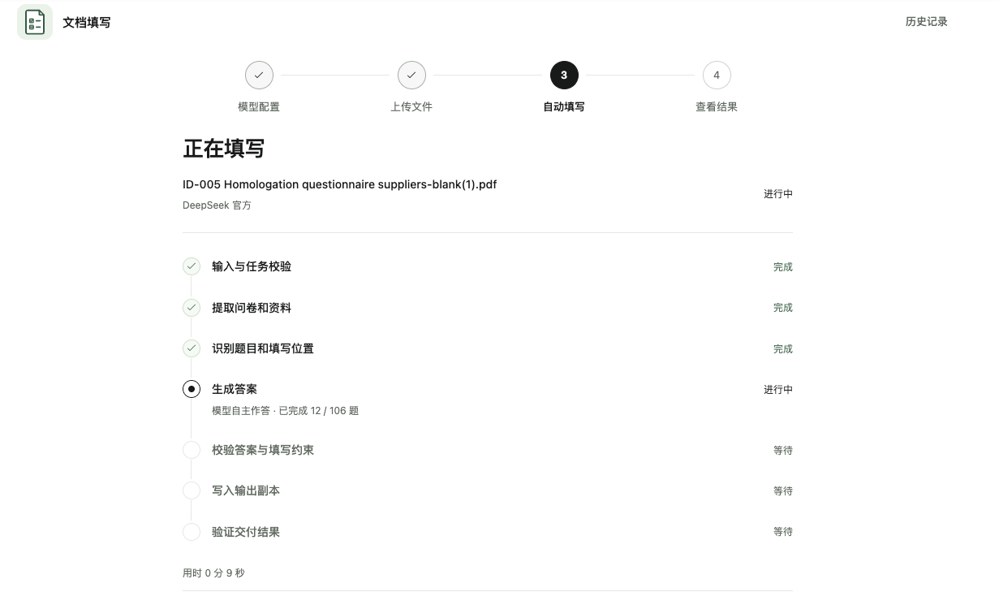
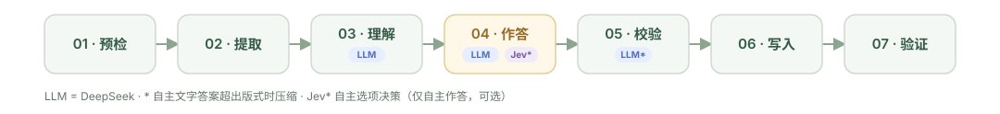

<p align="center">
  
</p>

<h1 align="center">DocFlow</h1>

<p align="center">
  本地运行的文档工作台：读取问卷和资料，生成并校验答案，再交付经过验证的新文件。
</p>

<p align="center">
  
</p>

---

## 工作流程



问卷与资料按顺序经过七个节点；通过验证后交付新文件，原始文件保持不变。

问卷支持 PDF、DOC/DOCX、XLS/XLSX；资料还支持 CSV、TXT、Markdown、PNG/JPG，扫描件可进行 OCR。

| 节点 | 要点 |
| --- | --- |
| **预检** | 检查文件格式、结构和处理限制，不符合要求即停止。 |
| **提取** | 提取题目、填写位置和资料内容。 |
| **理解** | 识别题意、题型和对应的填写位置。 |
| **作答** | 依据资料生成答案，或自主作答并记录假设。 |
| **校验** | 核对答案、证据和填写位置，只放行可写结果。 |
| **写入** | 将可写答案填入新副本，原件保持不变。 |
| **验证** | 回读检查内容与版式，验证失败则扣留文件。 |

## 作答方式

| 模式 | 输入 | 结果特点 |
| --- | --- | --- |
| **依据资料填写** | 问卷 + 一份或多份资料 | 答案关联资料证据；证据不足或资料冲突时留待复核或留空。 |
| **模型自主作答** | 问卷 | 模型按题目生成答案，报告会标出假设；可额外配置 Jev 官方服务辅助选择题决策。 |

两种模式都由 DeepSeek 官方模型生成候选答案。模型服务会收到本次处理所需的文档内容，请根据服务商的数据处理规则配置和使用。

## 技术原理

服务端按七节点顺序执行：模型生成候选答案，程序校验后写入副本并验证，通过后才交付。

## 快速启动

安装 Docker、Docker Compose 和 Make 后，在仓库根目录运行：

```sh
make start
```

服务就绪后终端会显示访问地址，默认是 <http://127.0.0.1:8765>。首次使用请配置 DeepSeek 官方模型；自主作答的选项决策可按需配置 Jev 官方服务。

停止服务：

```sh
make stop
```

## 项目结构

| 目录 | 内容 |
| --- | --- |
| `web/` | Vue 页面、前端状态与 API 客户端 |
| `server/` | FastAPI、应用用例、领域规则、workflow 节点和外部适配器 |
| `deploy/processor/` | 隔离运行的 Office 转换与 OCR 处理器 |
| `tests/` | 本地合成输入与假 HTTP 测试 |
| `docs/` | [架构说明](docs/architecture/architecture.md)、[节点契约](docs/architecture/workflow-nodes.md)、[API](docs/api/README.md) 和 [运维说明](docs/operations/operations.md) |
