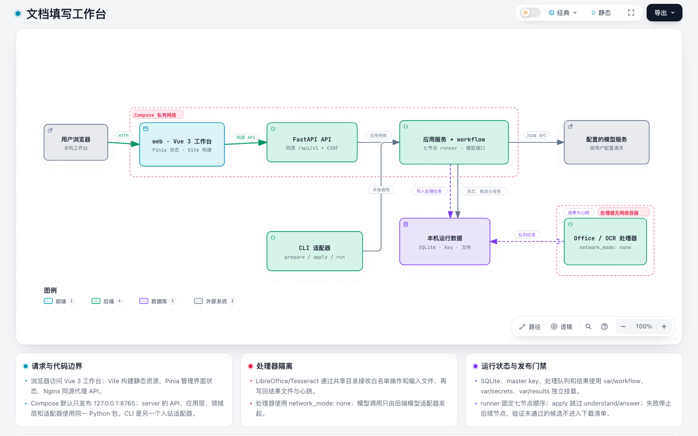

# Workflow 系统架构

本文描述当前代码和 Compose 部署。`web/` 的 Vue 页面、`server/` 的 FastAPI 和文档处理器是独立运行边界；Python 服务端内部按 application、domain 和 adapters 分层。整体是单机模块化单体，不是多租户服务或远程任务集群。



[交互式架构图](overview.html) · [Archify 图源](overview.archify.json)

## 请求路径与信任边界

```text
浏览器 ──同源──> Nginx (Vue 静态资源) ──私有 /api/v1──> FastAPI API
                                              │
CLI ───────────────> 应用服务 + 固定 workflow runner
                                              │
                    ┌─────────────────────────┼─────────────────────────┐
                    v                         v                         v
               SQLite 状态               配置的模型服务          无网络处理器
                                                                   │
                                                        共享任务目录──┘
```

- Compose 只把 `web` 端口发布到 loopback。Nginx 提供页面并代理 `/api/v1/`；`server` 不映射宿主机端口。
- API 验证可信 peer、预期 Host/Origin 及写请求 CSRF token。代理覆盖 `X-Forwarded-For` 为实际连接地址；不启用通配 CORS。
- 模型调用由后端适配器发起，目标来自用户配置。处理器容器通过共享任务目录收发固定的转换/OCR 请求，`network_mode: none`，不能访问模型服务或互联网。
- API 与处理器共用受限运行队列目录；SQLite 状态、Key 文件和结果分别挂载到 `var/workflow/`、`var/secrets/`、`var/results/`。
- 只有经回读和版式检查通过的候选文件进入公开下载清单；验证失败的候选留在结果目录供诊断。

部署事实见 [`compose.yaml`](../../compose.yaml)、[前端 Nginx 配置](../../web/nginx.conf) 和 [API Origin 检查](../../server/src/autofill/adapters/http/security.py)。

## 代码分层

| 层 | 目录/入口 | 唯一职责 |
| --- | --- | --- |
| 入站适配器 | `server/src/autofill/adapters/http/`、`adapters/cli.py` | 把 HTTP/CLI 输入验证并转换成应用调用；维护协议、状态码、安全请求门禁和兼容参数 |
| 应用用例 | `server/src/autofill/application/` | 配置与任务生命周期、幂等提交、取消、答案策略、依赖端口；不依赖 HTTP DTO 或 SQLite 实现 |
| 工作流执行 | `server/src/autofill/workflow/` | 七节点契约、顺序、状态、取消、失败停止和安全进度投影 |
| 领域规则 | `server/src/autofill/domain/` | Decision、Evidence、WritePlan、可发布性和领域错误；不执行外部 I/O |
| 出站适配器 | `server/src/autofill/adapters/` | 模型 HTTP、SQLite/加密 Key、文件格式操作，以及无网络处理器协议 |
| 浏览器客户端 | `web/src/`、`web/index.html` | Vue 组件与 Pinia 状态；通过统一 API 客户端访问服务端，Key 不进入持久化 UI 状态 |

`service.py` 负责装配 SQLite、模型、预检、问卷解析和处理器实现，并将这些端口注入应用服务。文档写入仅接受领域构造的 `WritePlan`。模型响应先解析并验证为 JSON 数据；文本不会被解释为 Python、Shell 或处理器操作代码。

HTTP、CLI、application、domain 和 adapters 共同打包在 `server` 镜像中；`web`、`server` 和转换/OCR 处理器是三个镜像。

## Workflow 节点执行规则

`WorkflowRunner` 接受且只接受固定的七个 `WorkflowStage`，由每个阶段 handler 返回 `NodeResult`。通用文档路径与固定模板兼容路径都接入同一 runner；handler 持有本阶段用例，runner 拥有顺序及停止决策。

进度事件仅含节点 ID、状态、UTC 时间、受限计数和安全错误码。结果产物在节点间通过内存 `WorkflowContext` 传递；数据库向旧任务视图投影五阶段兼容状态，不重写旧 schema。

| 操作 | 行为 |
| --- | --- |
| `run` | 依次执行七节点；每个节点返回后再进入下一阶段 |
| `apply` | 预检、提取、校验、写入、验证；理解与作答节点显式标记 `skipped` |
| 节点失败 | 记录安全错误码；后续节点标记 `skipped`，不会继续生成或写入 |
| 取消/中断 | 当前节点标记 `interrupted`，后续停止；不自动重放模型请求 |

逐节点输入/输出与门禁见[节点契约](workflow-nodes.md)。API 方法、上传、CSRF、幂等和下载契约见 [`docs/api/README.md`](../api/README.md) 与 [`docs/api/openapi.yaml`](../api/openapi.yaml)。

## 数据与发布边界

| 数据 | 默认位置 | 用途 |
| --- | --- | --- |
| SQLite 状态与事务日志 | `var/workflow/state/` | 配置元数据、加密后的 Key、任务状态与安全节点事件 |
| 处理器任务交换 | `var/workflow/processor-jobs/` | 后端创建的短期输入、固定操作请求和处理器响应 |
| 主密钥 | `var/secrets/master.key` | 解密 SQLite 中的加密模型 Key；与数据库必须成对备份 |
| 输出和诊断 | `var/results/` | 受控任务临时文件、验证候选、最终文件和报告 |

路径由 [`compose.yaml`](../../compose.yaml) 显式配置。新服务只在这些新运行位置保存状态；旧 `data/`、`secrets/`、`output/` 不作为迁移源。结果和报告可能含客户文件内容或答案，按敏感业务数据控制访问并加密备份。
